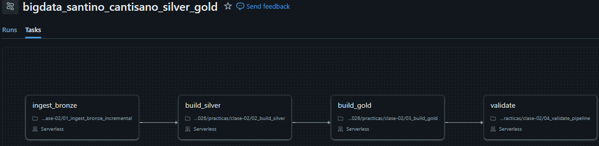
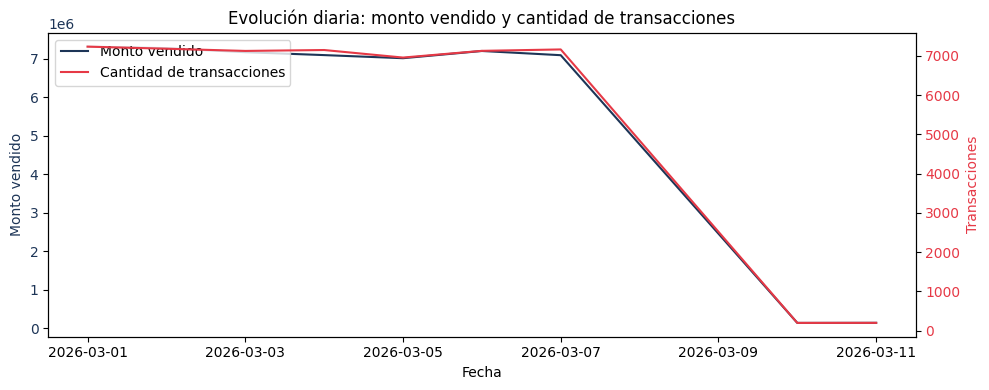
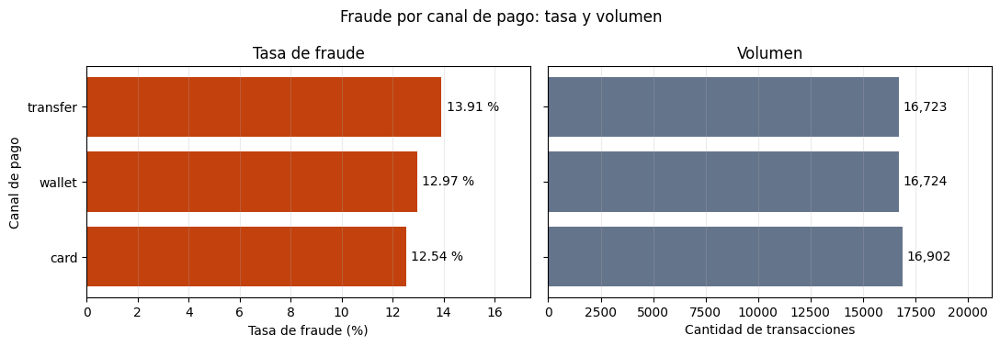
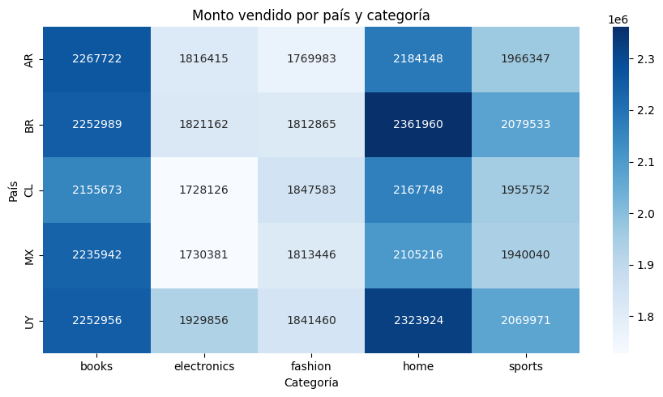
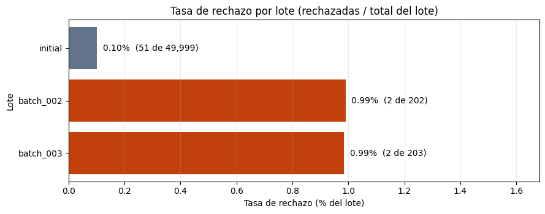

# Entrega práctica 2 — Silver, Gold y orquestación

- **Nombre:** Santino Cantisano
- **student_id:** santino_cantisano
- **Escala:** small
- **Job:** bigdata_santino_cantisano_silver_gold — https://dbc-2e9dc1cb-9e2a.cloud.databricks.com/jobs/616866986252062/tasks?o=7474660571674923

## DAG del Job



## Resultados de las ejecuciones

| Ejecución | expected_batch_id | Estado | idempotence_compared | silver_rows | quarantine_rows | gold_rows | gold_total_amount |
|---|---|---|---|---:|---:|---:|---:|
| 1 | batch_002 | Éxito | False | 50,149 | 53 | 598 | 50,286,183.33 |
| 2 | batch_002 | Éxito | True | 50,149 | 53 | 598 | 50,286,183.33 |
| 3 | batch_003 | Éxito | False | 50,349 | 55 | 669 | 50,431,198.33 |

La segunda ejecución dio exactamente las mismas métricas que la primera, ya que COPY INTO no volvió a cargar el archivo y el MERGE no duplicó filas.

**batch_002:** 200 aceptadas y 2 rechazadas (1 INVALID_AMOUNT y 1 UNKNOWN_CUSTOMER). Al momento de su ejecución eran 201 aceptadas, pero la corrección de la transacción 42 pasó después a batch_003.

## COPY INTO vs MERGE

COPY INTO evita cargar dos veces el mismo archivo: registra qué archivos ya procesó y en las siguientes corridas los saltea. No mira lo que hay adentro, entonces si el archivo trae duplicados o correcciones los carga igual.

MERGE trabaja a nivel transacción (transaction_id): inserta las nuevas, actualiza las que llegan con una versión más reciente y no hace nada con las que ya estaban. Uno resuelve archivos repetidos y el otro registros repetidos o corregidos.

## Análisis de las tablas

Todas las consultas corren sobre `workspace.bigdata_santino_cantisano`.

**1.** 204 filas físicas en cada lote. Incluyen el duplicado, la corrección de la 42 y los 2 registros inválidos, ya que COPY INTO carga el archivo tal cual.

```sql
SELECT source_batch_id, count(*) AS filas_fisicas
FROM bronze_transactions_incremental
GROUP BY source_batch_id
ORDER BY source_batch_id;
```

**2.** batch_002 tiene 200 aceptadas y 2 rechazadas, batch_003 201 y 2, e initial 49,948 y 51. Coinciden en los tres lotes con gold_batch_summary. La diferencia con las 204 filas de Bronze es el duplicado que se elimina y, en batch_002, la versión de la 42 que reemplazó batch_003.

```sql
WITH a AS (
  SELECT source_batch_id, count(*) AS aceptadas FROM silver_transactions GROUP BY source_batch_id
), r AS (
  SELECT source_batch_id, count(*) AS rechazadas FROM silver_transactions_quarantine GROUP BY source_batch_id
), calc AS (
  SELECT coalesce(a.source_batch_id, r.source_batch_id) AS source_batch_id,
         coalesce(a.aceptadas, 0) AS aceptadas, coalesce(r.rechazadas, 0) AS rechazadas
  FROM a FULL OUTER JOIN r ON a.source_batch_id = r.source_batch_id
)
SELECT c.source_batch_id, c.aceptadas, g.accepted_transactions,
       c.rechazadas, g.rejected_transactions,
       c.aceptadas = g.accepted_transactions AND c.rechazadas = g.rejected_transactions AS reconcilia
FROM calc c LEFT JOIN gold_batch_summary g ON c.source_batch_id = g.source_batch_id
ORDER BY c.source_batch_id;
```

**3.** En cada lote nuevo hay 1 INVALID_AMOUNT (monto N/A) y 1 UNKNOWN_CUSTOMER (customer_id 5999, que no existe), y en initial 51 INVALID_AMOUNT. Coinciden con lo que introduce el generador. El duplicado y la corrección de la 42 no van a cuarentena porque no son errores de calidad: uno se elimina y el otro se aplica como actualización.

```sql
SELECT source_batch_id, quality_reason, count(*) AS registros
FROM silver_transactions_quarantine
GROUP BY source_batch_id, quality_reason
ORDER BY source_batch_id, quality_reason;
```

**4.** Hay 3 versiones en Bronze: initial (600.11), batch_002 (1999.99) y batch_003 (1999.99). En Silver quedó la de batch_003 porque es la que tiene el updated_at más reciente (2026-03-11 02:00), que es lo que usan el row_number y el MERGE para elegir.

```sql
SELECT transaction_id, amount, event_ts, updated_at, source_batch_id
FROM bronze_transactions_all
WHERE try_cast(transaction_id AS BIGINT) = 42
ORDER BY updated_at;

SELECT transaction_id, amount, event_ts, updated_at, source_batch_id
FROM silver_transactions
WHERE transaction_id = 42;
```

| Tabla | amount | event_ts | updated_at | source_batch_id |
|---|---:|---|---|---|
| Bronze | 600.11 | 2026-03-06 02:07:52 | 2026-03-06 02:07:52 | initial |
| Bronze | 1999.99 | 2026-03-10 00:00:00 | 2026-03-10 02:00:00 | batch_002 |
| Bronze | 1999.99 | 2026-03-11 00:00:00 | 2026-03-11 02:00:00 | batch_003 |
| Silver | 1999.99 | 2026-03-11 00:00:00 | 2026-03-11 02:00:00 | batch_003 |

**5.** 50,349 filas y 50,349 IDs distintos, y la segunda consulta no devuelve nada. Si la deduplicación fallara habría más filas que IDs distintos, o algún ID con más de una fila.

```sql
SELECT count(*) AS filas, count(DISTINCT transaction_id) AS ids_distintos
FROM silver_transactions;

SELECT transaction_id, count(*) AS n
FROM silver_transactions
GROUP BY transaction_id
HAVING count(*) > 1;
```

**6.** 0.99% en batch_002 y batch_003, y 0.10% en initial. No es correcto comparar cantidades absolutas, ya que initial tiene más rechazos (51 contra 2) pero es 250 veces más grande, y en proporción rechaza 10 veces menos.

```sql
SELECT source_batch_id, accepted_transactions, rejected_transactions,
       round(rejected_transactions / (accepted_transactions + rejected_transactions), 4) AS tasa_rechazo
FROM gold_batch_summary
ORDER BY source_batch_id;
```

**7.** Coinciden: el 2026-03-01 tiene el mayor monto (7,310,840.77) y la mayor cantidad de transacciones (7,236). Igual no tienen por qué coincidir, en el tercer puesto ya se separan (el 07 tiene más transacciones que el 06 pero menos monto).

```sql
SELECT sale_date, sum(total_amount) AS monto, sum(transaction_count) AS transacciones
FROM gold_daily_sales
GROUP BY sale_date
ORDER BY monto DESC
LIMIT 3;

SELECT sale_date, sum(total_amount) AS monto, sum(transaction_count) AS transacciones
FROM gold_daily_sales
GROUP BY sale_date
ORDER BY transacciones DESC, monto DESC
LIMIT 3;
```

**8.** transfer, con 13.91% (wallet 12.97% y card 12.54%). No corresponde promediar fraud_rate porque cada fila es un grupo de distinto tamaño, y el promedio simple le da el mismo peso a un grupo de 5 transacciones que a uno de 200.

```sql
SELECT payment_channel,
       sum(fraud_transactions) AS fraudes,
       sum(transaction_count) AS transacciones,
       round(sum(fraud_transactions) / sum(transaction_count), 4) AS tasa_fraude_global
FROM gold_daily_sales
GROUP BY payment_channel
ORDER BY tasa_fraude_global DESC;
```

**9.** BR y home, con 2,361,959.97. Dentro de cada país lidera home en BR, UY y CL, y books en AR y MX.

```sql
WITH pc AS (
  SELECT country, category, sum(total_amount) AS monto
  FROM gold_daily_sales GROUP BY country, category
)
SELECT country, category, monto
FROM pc
QUALIFY row_number() OVER (PARTITION BY country ORDER BY monto DESC) = 1
ORDER BY monto DESC;
```

**10.** Se mantienen iguales silver_rows (50,149), quarantine_rows (53), gold_rows (598) y gold_total_amount (50,286,183.33). Solo cambian job_run_id y recorded_at. La columna que demuestra la comparación es idempotence_compared, que pasa de False a True en la reejecución.

```sql
SELECT job_run_id, expected_batch_id, silver_rows, quarantine_rows, gold_rows,
       gold_total_amount, idempotence_compared, recorded_at
FROM pipeline_run_audit
ORDER BY recorded_at;
```

## Interpretación del código

**11.** Resuelve la carga incremental de archivos (`01_ingest_bronze_incremental`, celda de COPY INTO). Guarda en los metadatos de la tabla Delta qué archivos ya cargó, por su ruta, entonces en cada corrida solo carga los nuevos.

**12.** Porque Bronze tiene que guardar todo lo que llegó, incluidas las versiones repetidas, para poder auditar (`01_ingest_bronze_incremental`, vista unificada). Los duplicados de negocio se resuelven en Silver, ya que ahí están los tipos y las reglas para decidir qué versión es la vigente.

**13.** Porque la tabla de la práctica 1 no tiene esas columnas y la vista las completa para que las dos fuentes tengan el mismo esquema. Al usar event_ts como updated_at, la versión inicial de la 42 queda como la más vieja, entonces la corrección gana tanto en el row_number como en el MERGE.

**14.** Con un cast convencional, un solo N/A tira error y frena toda la consulta (`quality_rules`, add_transaction_types). try_cast devuelve null, el registro va a cuarentena como INVALID_AMOUNT y el resto del lote se procesa normal.

**15.** Queda con la primera regla que viola, ya que el when se corta en la primera condición verdadera (`quality_rules`, add_quality_reason). El orden importa porque define qué motivo se reporta, y va de formato a referencial: no tiene sentido validar si existe un cliente cuyo ID no se pudo tipar.

**16.** Es el transaction_id como texto y, si no se puede convertir a número, un hash de todas las columnas (`02_build_silver`). El row_number agrupa por esa clave y se queda con la versión de updated_at más reciente. El hash evita que todos los IDs inválidos queden con clave null y se pisen entre sí, perdiendo registros que deberían ir a cuarentena.

**17.** Si el transaction_id ya existe y la versión que llega es más nueva, actualiza la fila (`02_build_silver`, MERGE). Si no existe, la inserta. Si existe y no es más nueva no hace nada, que es lo que permite reejecutar sin cambiar los datos.

**18.** Gold se reconstruye completo porque es simple y siempre queda consistente con Silver, pero recalcula todo el histórico en cada corrida. Silver usa MERGE porque solo aplica los cambios y guarda el historial de la tabla, pero depende de que la clave y la condición estén bien definidas.

**19.** Porque el archivo nuevo lo detecta COPY INTO en `01_ingest_bronze_incremental`, que lee toda la carpeta sin importar el nombre del lote. El parámetro lo usa `04_validate_pipeline` para verificar que ese lote llegó a cada capa (y `01` lo chequea en Bronze apenas termina la carga).

**20.** build_gold y validate quedan omitidas, ya que dependen de build_silver con la condición All succeeded. Así Gold no se arma sobre un Silver incompleto y no se registra una auditoría de una corrida que falló.

## Visualizaciones

En todas las consignas se agrega con Spark sobre las tablas Gold y solo el resultado chico se pasa a Pandas.

### Consigna 1 — Evolución temporal

¿Qué día tuvo el mayor monto vendido y ese día también fue el de mayor cantidad de transacciones?



Sí, el 2026-03-01 tuvo el mayor monto (7,310,840.77) y la mayor cantidad de transacciones (7,236). La caída de los días 10 y 11 corresponde a los lotes nuevos, que tienen unas 200 transacciones cada uno.

### Consigna 2 — Canal y fraude

¿Qué canal de pago presenta la mayor tasa de fraude? ¿La conclusión se sostiene al considerar el número de transacciones de cada canal?



Transfer, con 13.91% contra 12.97% de wallet y 12.54% de card. Se sostiene, ya que los tres canales tienen casi el mismo volumen (entre 16,723 y 16,902 transacciones).

### Consigna 3 — Concentración geográfica y de producto

¿Qué combinación de país y categoría genera el mayor monto? ¿Existe una categoría dominante en todos los países o cambia según el mercado?



La combinación más alta es BR y home (2,361,959.97). No hay una categoría dominante: home lidera en BR, UY y CL, y books en AR y MX.

### Consigna 4 — Calidad del pipeline

¿Qué proporción de cada lote fue aceptada y rechazada? ¿El lote nuevo presenta una calidad diferente del lote inicial?



Initial aceptó el 99.90% y los lotes nuevos el 99.01%. La tasa de rechazo de los nuevos es 10 veces mayor, pero no significa peor calidad, ya que el generador siempre mete 2 registros inválidos y en un lote de 200 filas cada uno mueve la tasa medio punto.
