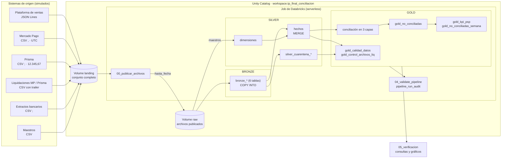
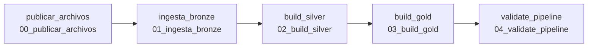
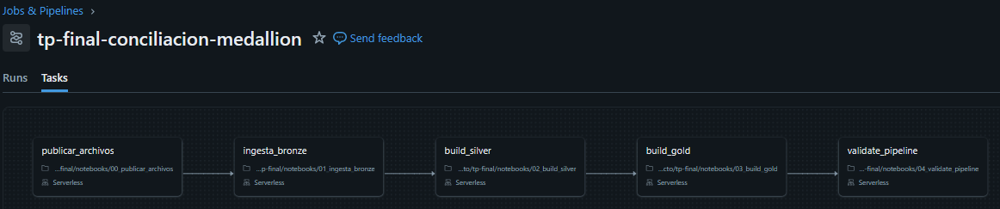
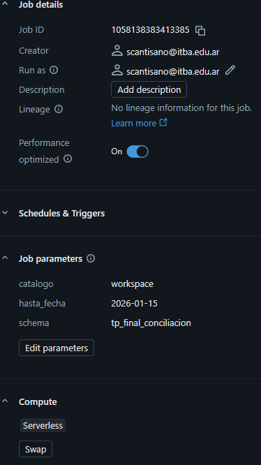
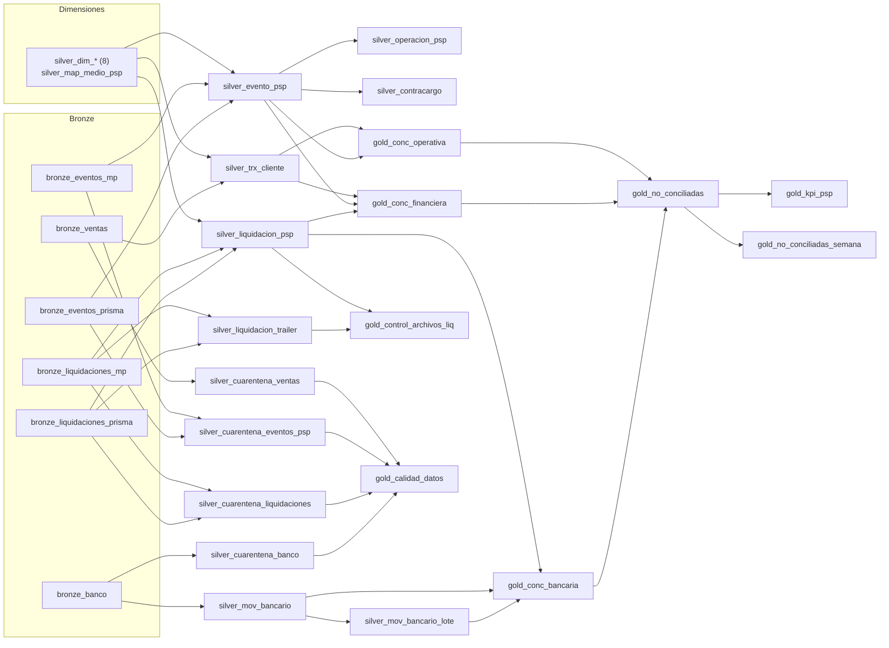

# 2. Arquitectura y pipeline

Esta sección presenta la arquitectura propuesta, el recorrido de los datos desde su llegada hasta su consumo, la configuración y el orden de ejecución del Job, las tecnologías seleccionadas y las principales decisiones técnicas adoptadas.

## Vista general

## Recorrido de los datos

1. **Publicación.** Los archivos de todos los sistemas de origen se depositan en el Volume `landing`. La tarea `00_publicar_archivos` los publica en el Volume `raw` hasta la fecha de corte indicada por el parámetro `hasta_fecha`. La separación entre ambas ubicaciones permite simular la llegada de archivos en lotes sucesivos, tal como ocurriría con una transferencia por SFTP o una integración diaria.
2. **Bronze.** La tarea `01_ingesta_bronze` carga cada fuente en una tabla Delta mediante `COPY INTO`, que procesa exclusivamente los archivos no cargados previamente. Los datos se almacenan como texto, junto con tres columnas de linaje: archivo de origen, fecha de modificación del archivo y momento de ingesta.
3. **Silver.** La tarea `02_build_silver` procesa cada entidad en tres pasos:
   - una vista de staging asigna tipos, traduce montos, fechas y códigos de cada PSP a la codificación interna y determina el motivo de rechazo de cada registro, si lo hubiera;
   - los registros válidos se deduplican y se integran a la tabla Silver mediante `MERGE`, que inserta únicamente las claves nuevas;
   - los registros inválidos se integran a la tabla de cuarentena correspondiente, junto con el motivo de rechazo.
4. **Gold.** La tarea `03_build_gold` efectúa la conciliación de las tres capas con la lógica del Data Warehouse original y reconstruye los productos de datos.
5. **Validación.** La tarea `04_validate_pipeline` ejecuta los controles del diseño y registra las métricas de la ejecución en `pipeline_run_audit`. Si algún control falla, el Job finaliza en estado fallido.
6. **Consumo.** El notebook `05_verificacion`, de ejecución manual, consulta la capa Gold, contrasta los resultados con el ground truth y genera las visualizaciones.

## Configuración y orden de ejecución del Job

El Job está compuesto por cinco tareas de tipo notebook, ejecutadas sobre cómputo serverless y encadenadas mediante dependencias con la condición *All succeeded*. Cada tarea comienza únicamente si la anterior finalizó correctamente, de modo que Gold nunca se construye sobre un Silver incompleto y no se registra una auditoría de una ejecución fallida.

| Parámetro | Ámbito | Valor | Uso |
|---|---|---|---|
| `catalogo` | Job | `workspace` | Catálogo de Unity Catalog |
| `schema` | Job | `tp_final_conciliacion` | Schema que contiene los Volumes y todas las tablas |
| `hasta_fecha` | Job | `2026-01-15` o `2026-12-31` | Fecha de corte de los archivos publicados |
| `job_run_id` | Tarea `validate_pipeline` | `{{job.run_id}}` | Identificador de la ejecución registrado en la auditoría |

La definición completa se encuentra en `job/job_config.json`. Las figuras siguientes muestran el grafo de tareas y los parámetros del Job tal como quedaron configurados en Databricks.

Dentro de cada tarea, las tablas se construyen en el orden de sus dependencias:

## Tecnologías

| Necesidad | Tecnología | Justificación |
|---|---|---|
| Almacenamiento de archivos | Volumes de Unity Catalog | Los archivos quedan bajo el gobierno de Unity Catalog sin necesidad de montar almacenamiento externo. Se encuentran disponibles en Free Edition. |
| Formato de tablas | Delta Lake | Es el formato por defecto de la plataforma y ofrece transacciones ACID, historial de versiones, validación de esquema y soporte para `MERGE`. |
| Ingesta | `COPY INTO` | Carga de forma idempotente únicamente los archivos nuevos e incorpora columnas nuevas mediante `mergeSchema`. |
| Integración incremental | `MERGE INTO` | Inserta en Silver solo las claves no registradas previamente, por lo que una reejecución no modifica las tablas. |
| Transformación | Notebooks con Spark SQL | La lógica de conciliación del Data Warehouse original se traduce de PostgreSQL a Spark SQL con cambios mínimos. |
| Orquestación | Job de Databricks | Encadena las tareas con dependencias, parámetros y estado por tarea. |
| Calidad de datos | Reglas en SQL, tablas de cuarentena y tarea de validación | Cada registro rechazado conserva su motivo; los controles de la última tarea detienen el Job ante una inconsistencia. |
| Cómputo | Serverless | Elimina la administración de clusters y es la única opción disponible en Free Edition. |
| Gobierno | Unity Catalog (catálogo, schema y tablas) | Provee el linaje entre tablas y el control de permisos. |
| Visualización | Notebook con Spark y matplotlib | Las agregaciones se calculan con Spark y solo el resultado agregado se grafica; el notebook exportado conserva resultados y gráficos. |

## Decisiones técnicas

**Almacenamiento como texto en Bronze.** Las opciones `inferSchema = false` (CSV) y `primitivesAsString = true` (JSON) evitan que Bronze asigne tipos. Si lo hiciera, un monto `"N/A"` o una fecha `31/02/2026` se convertirían en `NULL` sin advertencia alguna, y se perdería registro de lo efectivamente recibido. Al almacenar texto, Bronze constituye una copia fiel del origen y el tipado se traslada a Silver, donde cada descarte puede medirse y justificarse.

**`COPY INTO` en lugar de Auto Loader.** Ambos procesan únicamente los archivos nuevos. Se optó por `COPY INTO` porque se ejecuta en modo batch dentro de una tarea del Job, es idempotente por archivo y, con `mergeSchema = true`, incorpora las columnas nuevas (`coupon_code` e `installments`) sin interrumpir la carga. Con Auto Loader, la aparición de una columna nueva detiene el flujo y requiere un reintento de la tarea. Para el volumen del caso, en el orden de cientos de archivos por mes, `COPY INTO` resulta suficiente.

**Integración incremental en Silver y reconstrucción completa en Gold.** Silver integra los registros válidos con `MERGE ... WHEN NOT MATCHED THEN INSERT`, que conserva el primer registro recibido y garantiza que una reejecución no duplique filas. Gold, en cambio, se reconstruye completo desde Silver en cada ejecución: la conciliación realiza `FULL OUTER JOIN` entre fuentes que arriban con días de diferencia (la liquidación se recibe en T+1 o T+2), y un recálculo completo asegura que cada partida refleje la información disponible al momento de la ejecución. El costo de este recálculo es bajo para el volumen del caso.

**Vínculo entre venta y PSP resuelto en Gold.** El PSP desconoce el `order_id` de la plataforma; solo dispone de la `external_reference` que esta le transmite. El vínculo se resuelve en Gold, al momento de conciliar, y no se almacena en Silver. Si se almacenara durante la integración, un evento recibido antes que su venta quedaría vinculado a un `id_trx` nulo de forma permanente, dado que el `MERGE` solo inserta claves nuevas. Cuando la referencia de un evento no existe en la plataforma, Gold lo clasifica como fantasma PSP.

**Motivo de rechazo único y ordenado.** Cada registro inválido recibe un único motivo: el de la primera regla que incumple, evaluadas desde el formato hacia la integridad referencial (identificador, fecha, monto, referencias a maestros). No tiene sentido, por ejemplo, validar si existe un usuario cuyo identificador no pudo convertirse a número. Todas las conversiones emplean las variantes `try_*`, de modo que un valor inválido produce `NULL` y el registro se deriva a cuarentena en lugar de provocar la falla de la tarea completa.

**Tabla puente entre movimiento bancario y lote.** En el Data Warehouse original, los movimientos bancarios se vinculaban con los lotes mediante la condición `descripcion LIKE '%' || lote || '%'`, un join sin condición de igualdad que obliga a comparar todos los registros entre sí. En el presente trabajo, Silver extrae los lotes del concepto hacia una tabla puente, lo que permite a Gold resolver el cruce mediante un join por igualdad.

**Independencia respecto de la zona horaria de la sesión.** Las ventas incluyen el desplazamiento horario local, por lo que la fecha se obtiene directamente de la porción de fecha del texto. Mercado Pago informa en UTC; en consecuencia, la marca temporal se convierte primero a `America/Argentina/Buenos_Aires` y luego se extrae la fecha. De lo contrario, un evento registrado a las 22 h se asignaría al día siguiente.

**Validación como última tarea del Job.** Los supuestos del diseño (claves únicas, cobertura completa de la conciliación, integridad de los archivos, respeto de la fecha de corte) se verifican en cada ejecución. Además, la tabla `pipeline_run_audit` registra las métricas de cada ejecución; cuando una ejecución repite la fecha de corte de la anterior, la tarea verifica que las métricas no se hayan modificado.

**Parametrización.** El catálogo, el schema y la fecha de corte se definen como parámetros del Job y no en el código, lo que permite reutilizar los notebooks en otro workspace y repetir la demostración incremental sin modificarlos.

**Lectura de los datos maestros en modo batch.** Se trata de tablas de referencia de tamaño reducido, que se leen en forma completa en cada ejecución y reemplazan a la versión anterior, sin conservar historial. Si fuera necesario conservar las versiones previas (por ejemplo, ante un cambio de comisión de un PSP), debería registrarse cada versión con su período de vigencia.
