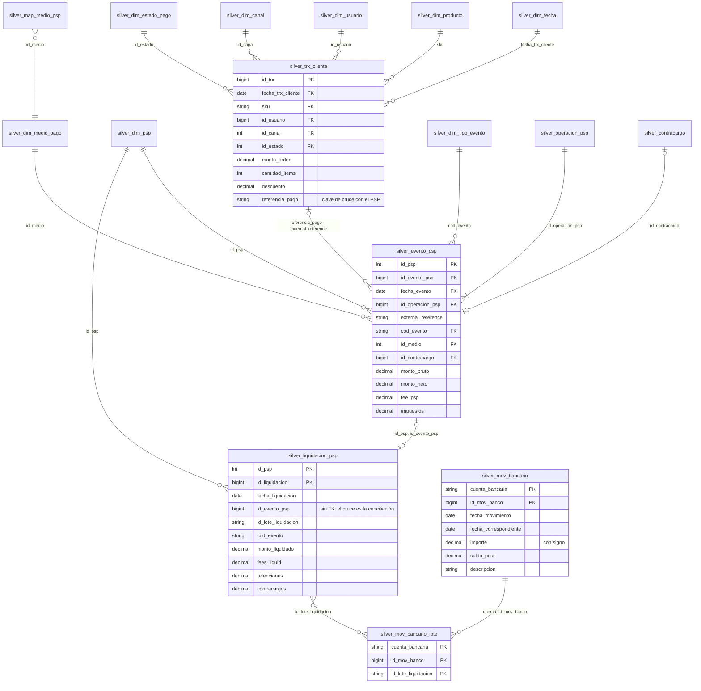

# 3. Modelado de las tablas y reglas de transformación

Esta sección describe las tablas de cada capa, el modelo de datos de la capa Silver y las reglas de transformación, de calidad y de conciliación aplicadas.

## Tablas por capa

### Bronze: copia fiel del origen

| Tabla | Carga | Grano | Columnas agregadas |
|---|---|---|---|
| `bronze_ventas` | `COPY INTO` (incremental por archivo) | 1 línea JSON | `_archivo_origen`, `_archivo_modificado`, `_fecha_ingesta` |
| `bronze_eventos_mp` | ídem | 1 fila del reporte MP | ídem |
| `bronze_eventos_prisma` | ídem | 1 fila del reporte Prisma | ídem |
| `bronze_liquidaciones_mp` | ídem | 1 registro (D o T) | ídem |
| `bronze_liquidaciones_prisma` | ídem | 1 registro (D o T) | ídem |
| `bronze_banco` | ídem | 1 movimiento del extracto | ídem |

Las tablas se crean vacías y sin esquema; `COPY INTO` infiere el esquema en la primera carga y lo amplía cuando aparecen columnas nuevas (`mergeSchema`). Todas las columnas de origen se almacenan como `STRING`. Las tablas carecen de clave, por lo que un reenvío se registra como fila repetida. Este comportamiento es intencional: la capa Bronze refleja lo efectivamente recibido y no lo que resulta correcto.

### Silver: modelo integrado

La capa Silver conserva el modelo dimensional del Data Warehouse original (constelación de hechos). Algunas dimensiones se desnormalizaron, dado que, en este caso, los joins contra tablas de tamaño tan reducido no aportan beneficios y aumentan la complejidad de las consultas.

| Tabla | Rol | Grano | Clave | Carga |
|---|---|---|---|---|
| `silver_dim_fecha` | dimensión | 1 día (ene–feb 2026) | `fecha` | reemplazo |
| `silver_dim_producto` | dimensión (+ categoría) | 1 SKU | `sku` | reemplazo |
| `silver_dim_usuario` | dimensión (+ segmento) | 1 usuario | `id_usuario` | reemplazo |
| `silver_dim_canal` / `_estado_pago` / `_psp` / `_tipo_evento` | dimensiones | 1 código | `id_*` / `cod_evento` | reemplazo |
| `silver_dim_medio_pago` | dimensión (+ tipo, comercio) | 1 medio | `id_medio` | reemplazo |
| `silver_map_medio_psp` | traducción | 1 código de medio por PSP | `(id_psp, codigo_psp)` | reemplazo |
| `silver_trx_cliente` | **hecho** | 1 orden = 1 SKU | `id_trx` | `MERGE` |
| `silver_evento_psp` | **hecho** | 1 evento AUTH/CAPTURE/REFUND/CHBK | `(id_psp, id_evento_psp)` | `MERGE` |
| `silver_operacion_psp` | dimensión | 1 operación en el PSP | `(id_psp, id_operacion_psp)` | reemplazo |
| `silver_contracargo` | dimensión | 1 contracargo | `id_contracargo` | reemplazo |
| `silver_liquidacion_psp` | **hecho** | 1 evento liquidado en un lote | `(id_psp, id_liquidacion)` | `MERGE` |
| `silver_liquidacion_trailer` | control | 1 archivo de liquidación | `(id_psp, _archivo_origen)` | reemplazo |
| `silver_mov_bancario` | **hecho** | 1 movimiento | `(cuenta_bancaria, id_mov_banco)` | `MERGE` |
| `silver_mov_bancario_lote` | puente | 1 lote mencionado en un movimiento | `(cuenta_bancaria, id_mov_banco, id_lote_liquidacion)` | reemplazo |
| `silver_cuarentena_*` (4) | control | 1 fila descartada | — (+ `motivo_calidad`) | `MERGE` |

Las tablas de hechos y de cuarentena se integran de forma incremental mediante `MERGE`, que inserta únicamente las claves nuevas; el resto se reemplaza en cada ejecución por tratarse de tablas pequeñas derivadas. Las vistas de staging (`_stg_*`) son temporales y no se persisten.

Las modificaciones introducidas respecto del modelo original son las siguientes:
- la tabla `Mes` y la función `semana_del_mes()` se reemplazaron por columnas de `silver_dim_fecha`, dado que una función definida por el usuario no es portable entre motores, mientras que una columna sí lo es;
- las tablas `Producto` y `Categoria`, `Usuario` y `Segmento`, y `Medio_Pago`, `Tipo_Medio` y `Comercio` se unificaron en una única tabla por grupo, con el consiguiente paso de un esquema copo de nieve a uno estrella;
- se incorporaron `silver_map_medio_psp` y los códigos de cada PSP en `silver_dim_tipo_evento`, puesto que en el modelo original los datos ya contenían los identificadores internos, mientras que en este caso deben traducirse;
- se incorporó el atributo `referencia_pago` en `silver_trx_cliente`, que constituye la clave efectiva del cruce con el PSP;
- la tabla `silver_mov_bancario_lote` reemplaza la condición `LIKE` sobre la descripción (véase la sección de arquitectura);
- el `importe` de los movimientos bancarios se expresa con signo, dado que el extracto informa débitos y créditos por separado.

### Gold: productos de datos

| Tabla | Grano | Uso |
|---|---|---|
| `gold_conc_operativa` | 1 (venta, operación PSP) | Venta vs. PSP: fantasmas, diferencias de monto, rechazos, devoluciones |
| `gold_conc_financiera` | 1 (evento, liquidación) | PSP vs. liquidación: pendientes, huérfanas, diferencias de fee, atrasos |
| `gold_conc_bancaria` | 1 (lote, movimiento) | Liquidación vs. banco: sin acreditar, fecha distinta, movimientos sin lote |
| `gold_no_conciliadas` | 1 partida no conciliada | Partidas a revisar por el analista, con capa, motivo, monto y comentario |
| `gold_kpi_psp` | 1 PSP | Costo efectivo, plazos, contracargos, tasa de conciliación, pérdida por capa |
| `gold_no_conciliadas_semana` | mes × semana × PSP × capa × motivo | Evolución temporal |
| `gold_control_archivos_liq` | 1 archivo de liquidación | Trailer vs. suma del detalle |
| `gold_calidad_datos` | 1 fuente | Filas en Bronze, cuarentena, duplicados y Silver |
| `pipeline_run_audit` | 1 ejecución del Job | Métricas por ejecución y verificación de idempotencia |

Todas las tablas Gold se reconstruyen completas desde Silver en cada ejecución. La tabla `pipeline_run_audit`, generada por la tarea de validación, solo incorpora filas.

## Diagrama del modelo (Silver)

El vínculo entre venta y evento no se almacena en Silver: se resuelve en Gold mediante la igualdad entre `referencia_pago` y `external_reference`, de modo que un evento recibido antes que su venta no quede desvinculado de forma permanente. Un evento sin venta asociada se clasifica como fantasma PSP.

Las relaciones entre hechos de distintas capas (venta–evento, evento–liquidación y lote–banco) se definieron intencionalmente como opcionales, dado que la conciliación tiene por objeto detectar, precisamente, la ausencia de la contraparte. Por este motivo, no se declararon como restricciones de integridad referencial, sino que se evalúan en la capa Gold.

## Reglas de transformación (Bronze → Silver)

| Regla | Fuente | Detalle |
|---|---|---|
| Montos con punto | MP, ventas | `try_cast(x AS DECIMAL(14,2))` |
| Montos `12.345,67` | Prisma, liquidaciones Prisma, banco | eliminación del separador de miles, reemplazo de la coma decimal y posterior `try_cast` |
| Fecha con offset local | ventas | porción de fecha del texto (`substr(created_at, 1, 10)`) |
| Fecha-hora UTC | MP | `convert_timezone('UTC', 'America/Argentina/Buenos_Aires', …)` y posterior extracción de la fecha |
| Fecha `dd/mm/yyyy` | Prisma, banco | `try_to_timestamp(x, 'dd/MM/yyyy')`; una fecha inexistente devuelve `NULL` |
| Códigos de evento | MP / Prisma | `authorization`/`AUT` → `AUTH`, entre otros, mediante `silver_dim_tipo_evento` |
| Medio de pago | MP / Prisma | `visa`/`VISA CREDITO` → `id_medio` 1, mediante `silver_map_medio_psp` |
| Estado y canal | ventas | `lower(trim(x))` y cruce con el maestro |
| `id_trx` del evento | eventos (en Gold) | cruce `external_reference` = `referencia_pago` de la venta |
| Débito / crédito | banco | `importe = crédito − débito` |
| Lotes del movimiento | banco | expresión regular sobre el concepto y `explode` hacia la tabla puente |
| Registro trailer | liquidaciones | `tipo_registro = 'T'` no representa una operación, por lo que se excluye y se utiliza en `gold_control_archivos_liq` |
| Duplicados | todas | `row_number()` por clave natural, conservando el primer registro recibido, y `MERGE` que inserta solo claves nuevas |

En todos los casos se emplearon las variantes `try_*` (`try_cast`, `try_to_timestamp` y `try_element_at`). Una conversión convencional (`CAST`) sobre un valor inválido provoca la falla de la tarea completa a causa de una única fila. Con las variantes `try_*`, el valor resulta `NULL` y el registro se deriva a cuarentena con el motivo correspondiente.

## Reglas de calidad y motivos de rechazo

Cada registro inválido recibe un único `motivo_calidad`: el de la primera regla que incumple, según el orden de la tabla, que avanza desde el formato hacia la integridad referencial. Los registros rechazados se conservan en la tabla de cuarentena de su entidad, junto con los valores originales recibidos.

| Entidad | Motivos, en orden de evaluación | Cuarentena |
|---|---|---|
| Ventas | `ID_INVALIDO`, `FECHA_INVALIDA`, `MONTO_INVALIDO` (no numérico o no positivo), `USUARIO_AUSENTE`, `ESTADO_DESCONOCIDO`, `CANAL_DESCONOCIDO`, `SKU_DESCONOCIDO`, `REFERENCIA_AUSENTE` | `silver_cuarentena_ventas` |
| Eventos PSP | `ID_INVALIDO`, `FECHA_INVALIDA`, `MONTO_BRUTO_INVALIDO`, `MONTO_NETO_INVALIDO`, `TIPO_EVENTO_DESCONOCIDO`, `MEDIO_DESCONOCIDO`, `OPERACION_AUSENTE` | `silver_cuarentena_eventos_psp` |
| Liquidaciones (registros D) | `ID_INVALIDO`, `FECHA_INVALIDA`, `LOTE_AUSENTE`, `MONTO_INVALIDO`, `TIPO_EVENTO_DESCONOCIDO` | `silver_cuarentena_liquidaciones` |
| Movimientos bancarios | `ID_INVALIDO`, `FECHA_INVALIDA`, `IMPORTE_INVALIDO`, `CUENTA_AUSENTE` | `silver_cuarentena_banco` |

Las variaciones de escritura que pueden corregirse sin ambigüedad, como un estado con mayúsculas o espacios (`" Approved "`), se normalizan y no se descartan; la columna `estado_normalizado` permite identificarlas.

Por su parte, la tarea `04_validate_pipeline` verifica en cada ejecución los supuestos del modelo: claves únicas en los hechos, cobertura completa de la conciliación, integridad de los archivos de liquidación y respeto de la fecha de corte. El supuesto de un único SKU por orden se informa como advertencia, sin detener el Job.

## Reglas de conciliación (Gold)

Se conservan las reglas definidas en el Data Warehouse original:
- **Operativa** (`FULL OUTER JOIN` entre cada venta y los eventos agrupados por operación): `FANTASMA_PSP`, `FANTASMA_CLIENTE`, `RECHAZO_OK`, `RECHAZO_INCONSISTENTE`, `DEVOLUCION_OK`, `CONTRACARGO_OK`, `SIN_CAPTURA`, `DIFERENCIA_MONTO` y `OK_CONCILIADO`. Se incorporaron dos estados que no existían en el modelo original: `DEVOLUCION_PENDIENTE` y `CONTRACARGO_PENDIENTE`, que corresponden a ventas registradas como devueltas o con contracargo cuyo evento todavía no fue informado por el PSP (T+3 y T+5, respectivamente). Estos casos no se presentaban en el Data Warehouse original porque los datos se cargaban completos; surgieron al procesar el mes en lotes sucesivos, donde la tarea de validación los detectó como partidas sin clasificar.
- **Financiera** (`FULL OUTER JOIN` entre evento y liquidación, excluyendo las autorizaciones): `LIQUIDACION_HUERFANA`, `PENDIENTE_LIQUIDACION`, `DIFERENCIA_TIPO_EVENTO`, `DIFERENCIA_FEE`, `FUERA_DE_PLAZO` y `OK_LIQUIDADO`. La única modificación consiste en que el plazo de liquidación se obtiene del maestro de PSP, en lugar de encontrarse fijo en el código.
- **Bancaria** (cruce entre lote y movimiento a través de la tabla puente, junto con los movimientos sin lote asociado): `SIN_ACREDITAR`, `MOVIMIENTO_SIN_LOTE`, `FECHA_ACREDITACION_DISTINTA` y `OK_ACREDITADO`.

## Respuesta a las preguntas de negocio

| Pregunta | Tabla |
|---|---|
| ¿Cuánto monto no concilia, en qué capa y por qué motivo? | `gold_no_conciliadas` |
| ¿Qué PSP tiene mayor costo y cuál liquida más rápido? | `gold_kpi_psp` |
| ¿Las pérdidas aumentan hacia fin de mes? | `gold_no_conciliadas_semana` |
| ¿Se recibieron íntegros los archivos de liquidación? | `gold_control_archivos_liq` |
| ¿Cuántos registros se descartaron y por qué? | `gold_calidad_datos`, `silver_cuarentena_*` |
| Las 20 consultas OLAP del DW original | Pueden ejecutarse sobre Silver adaptando los nombres de las tablas |
