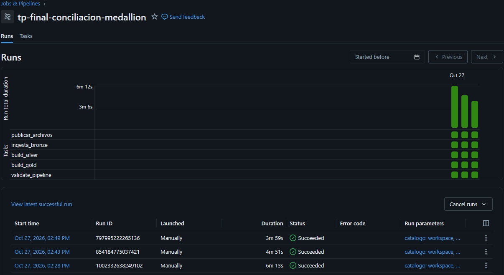
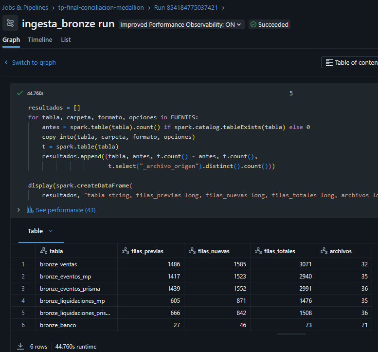
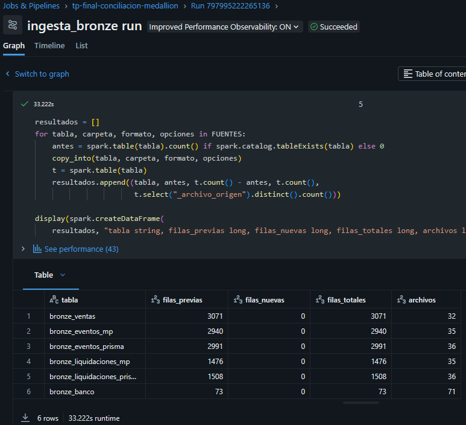
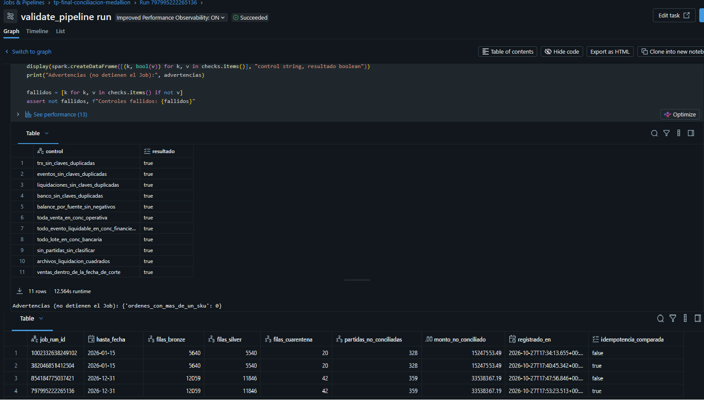
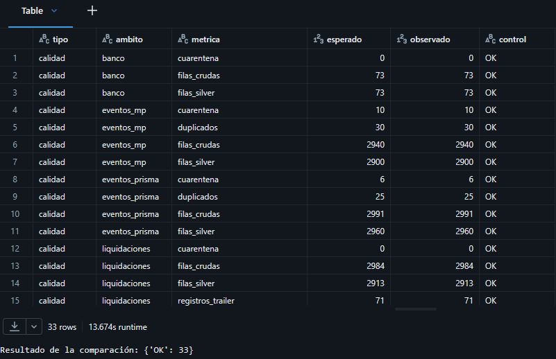
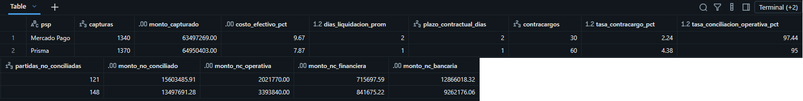
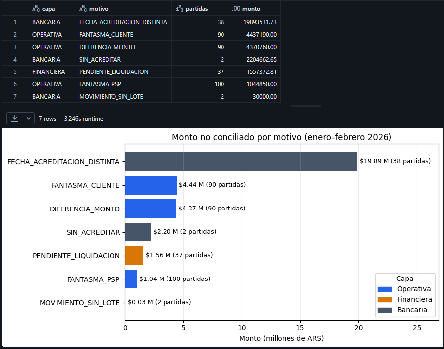
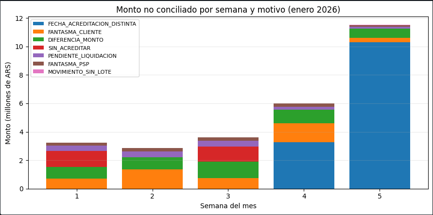
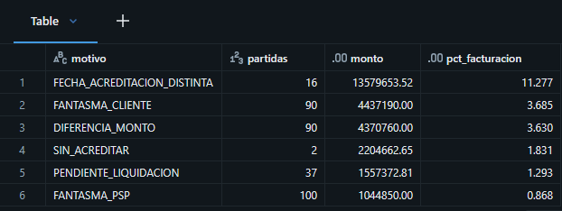

# 4. Resultados, verificación y limitaciones

Esta sección presenta los resultados de las ejecuciones del Job, su validación, la verificación contra los casos inyectados y contra el Data Warehouse original, una prueba de escala y las limitaciones del trabajo.

Los valores informados corresponden a la ejecución del Job `tp-final-conciliacion-medallion` en Databricks Free Edition, realizada el 27 de octubre de 2026 sobre cómputo serverless. Previamente, la misma secuencia se ejecutó en forma local con `tests/ejecutar_job_local.py` (PySpark 4.2), que arrojó valores idénticos. Las capturas completas se encuentran en [`evidencia/`](../evidencia/).

## Ejecuciones del Job

El Job se ejecutó tres veces sobre el mismo schema, y las tres ejecuciones finalizaron con éxito:

| Ejecución | Run ID | `hasta_fecha` | Duración | Filas nuevas en Bronze | Filas en Bronze | Filas en Silver | Cuarentena | Partidas no conciliadas | Monto no conciliado |
|---|---|---|---:|---:|---:|---:|---:|---:|---:|
| 1 | 1002332638249102 | 2026-01-15 | 6 min 13 s | 5.640 | 5.640 | 5.540 | 20 | 328 | $15.247.553,49 |
| 2 | 854184775037421 | 2026-12-31 | 4 min 51 s | 6.419 | 12.059 | 11.846 | 42 | 359 | $33.538.367,19 |
| 3 | 797995222265136 | 2026-12-31 | 3 min 59 s | 0 | 12.059 | 11.846 | 42 | 359 | $33.538.367,19 |

*Fuente: listado de ejecuciones del Job, salida de la tarea `ingesta_bronze` y tabla `pipeline_run_audit`.*

- **Ingesta incremental.** En la segunda ejecución, `COPY INTO` cargó únicamente los archivos publicados entre el 16 de enero y el 15 de febrero (6.419 filas nuevas), sin volver a procesar los de la primera quincena. Las columnas `coupon_code` e `installments`, que aparecen a partir del 16 de enero, se incorporaron al esquema de Bronze sin interrumpir la carga.

  

- **Idempotencia.** La tercera ejecución no cargó filas nuevas y produjo exactamente las mismas métricas que la segunda; la tarea de validación lo verificó de forma automática (`idempotencia_comparada = true`). La tabla de auditoría registra, además, una ejecución adicional del Job (identificador 382046851412504), lanzada entre la primera y la segunda con el valor por defecto de la fecha de corte (`2026-01-15`). Si bien no estaba prevista en la secuencia, reprodujo sin cambios las métricas de la primera ejecución y constituye, por lo tanto, una verificación adicional de la idempotencia. Esta ejecución no figura en el listado de ejecuciones del Job porque fue eliminada posteriormente; su registro se conserva en `pipeline_run_audit`, dado que eliminar una ejecución del historial del Job no revierte las escrituras que realizó sobre las tablas.

  

- **Validación.** Los once controles de la tarea `validate_pipeline` resultaron satisfactorios en todas las ejecuciones.

  

La primera ejecución pone de manifiesto el efecto de la llegada escalonada de la información. Con datos hasta el 15 de enero, 163 eventos liquidables figuran como `PENDIENTE_LIQUIDACION` ($7,09 M) y 30 ventas como `DEVOLUCION_PENDIENTE` o `CONTRACARGO_PENDIENTE` ($1,39 M), dado que sus liquidaciones o eventos posteriores todavía no habían sido recibidos. Con el mes completo, los eventos pendientes se reducen a las 37 capturas que efectivamente nunca se liquidaron y los estados pendientes desaparecen. Estos dos últimos estados no existían en el Data Warehouse original: se incorporaron al detectar la tarea de validación, durante la primera ejecución, partidas que quedaban sin clasificar.

## Volumen por capa

| Fuente | Filas Bronze | Estructurales | Cuarentena | Duplicados | Filas Silver | Aprovechamiento |
|---|---:|---:|---:|---:|---:|---:|
| Ventas | 3.071 | 0 | 26 | 45 | 3.000 | 97,69% |
| Eventos Mercado Pago | 2.940 | 0 | 10 | 30 | 2.900 | 98,64% |
| Eventos Prisma | 2.991 | 0 | 6 | 25 | 2.960 | 98,96% |
| Liquidaciones | 2.984 | 71 (trailers) | 0 | 0 | 2.913 | 97,62% |
| Banco | 73 | 0 | 0 | 0 | 73 | 100% |

*Fuente: `gold_calidad_datos`.*

Adicionalmente, 309 órdenes se recibieron con el estado escrito de forma irregular (`" Approved "`, `APPROVED`) y fueron normalizadas sin ser descartadas. Asimismo, los 71 archivos de liquidación resultaron consistentes con su registro trailer: en `gold_control_archivos_liq`, la totalidad figura con estado `OK` y una diferencia de 0,00.

## Valores esperados y observados

Las 33 métricas del ground truth coinciden con los valores observados. Estas abarcan las filas crudas, los duplicados, los registros en cuarentena y las filas finales de cada fuente, así como la cantidad de casos de cada estado de conciliación en las tres capas. La comparación corresponde a la sección 3 del notebook `05_verificacion`.

| Capa | Estado | Casos |
|---|---|---:|
| Operativa | OK_CONCILIADO | 2.280 |
| | RECHAZO_OK | 300 |
| | DEVOLUCION_OK | 150 |
| | CONTRACARGO_OK | 90 |
| | FANTASMA_CLIENTE | 90 |
| | DIFERENCIA_MONTO | 90 |
| | FANTASMA_PSP | 100 |
| Financiera | OK_LIQUIDADO | 2.913 |
| | PENDIENTE_LIQUIDACION | 37 |
| Bancaria | OK_ACREDITADO | 100 |
| | FECHA_ACREDITACION_DISTINTA | 38 |
| | SIN_ACREDITAR | 2 |
| | MOVIMIENTO_SIN_LOTE | 2 |

## Indicadores por PSP (`gold_kpi_psp`)

| Indicador | Mercado Pago | Prisma |
|---|---:|---:|
| Capturas | 1.340 | 1.370 |
| Monto capturado | $63.497.269 | $64.950.403 |
| Costo efectivo (comisión + IVA) | 9,67% | 7,87% |
| Días de liquidación (promedio / contractual) | 2,0 / 2 | 1,0 / 1 |
| Contracargos | 30 (2,24%) | 60 (4,38%) |
| Tasa de conciliación operativa | 97,44% | 95,00% |
| Monto no conciliado | $15.603.486 | $13.497.691 |
| · operativa / financiera / bancaria | $2,02 M / $0,72 M / $12,87 M | $3,39 M / $0,84 M / $9,26 M |

A los montos anteriores se suman 90 ventas aprobadas sin evento alguno en el PSP ($4,44 M), que no pueden atribuirse a ninguno de los dos proveedores.

Los resultados confirman las conclusiones del Data Warehouse original. Prisma presenta un menor costo efectivo y un plazo de liquidación más breve, mientras que Mercado Pago exhibe una mayor tasa de conciliación y la mitad de contracargos. La mayor parte del monto no conciliado se concentra en la capa bancaria y no en la operatoria de los PSP.

## Monto no conciliado por capa y motivo (`gold_no_conciliadas`)

| Capa | Motivo | Partidas | Monto |
|---|---|---:|---:|
| Bancaria | FECHA_ACREDITACION_DISTINTA | 38 | $19.893.531,73 |
| Operativa | FANTASMA_CLIENTE | 90 | $4.437.190,00 |
| Operativa | DIFERENCIA_MONTO | 90 | $4.370.760,00 |
| Bancaria | SIN_ACREDITAR | 2 | $2.204.662,65 |
| Financiera | PENDIENTE_LIQUIDACION | 37 | $1.557.372,81 |
| Operativa | FANTASMA_PSP | 100 | $1.044.850,00 |
| Bancaria | MOVIMIENTO_SIN_LOTE | 2 | $30.000,00 |

## Evolución semanal (`gold_no_conciliadas_semana`)

El monto no conciliado se mantiene estable durante las tres primeras semanas de enero y se incrementa de manera significativa hacia el cierre del mes, como consecuencia de las acreditaciones bancarias registradas con un día de demora. El motivo `FECHA_ACREDITACION_DISTINTA` acumula, por sí solo, $3,28 M en la semana 4 y $10,30 M en la semana 5.

## Paridad con el DW original

Con el mismo corte que la consulta D.2 del trabajo de Almacenes de Datos (enero de 2026, con una facturación aprobada de $120.413.830), los resultados coinciden al centavo:

| Causa | DW original (PostgreSQL) | Job actual (Spark) | % de la facturación |
|---|---:|---:|---:|
| Fecha de acreditación distinta | $13.579.653,52 | $13.579.653,52 | 11,277% |
| Fantasma del cliente | $4.437.190,00 | $4.437.190,00 | 3,685% |
| Diferencias de monto | $4.370.760,00 | $4.370.760,00 | 3,630% |
| Sin acreditar | $2.204.662,65 | $2.204.662,65 | 1,831% |
| Liquidaciones pendientes | $1.557.372,81 | $1.557.372,81 | 1,293% |
| Fantasma del PSP | $1.044.850,00 | $1.044.850,00 | 0,868% |

Los costos efectivos (9,67% y 7,87%) y los plazos de liquidación (2 y 1 días) también coinciden. La diferencia entre los $19,89 M y los $13,58 M correspondientes a fecha de acreditación distinta obedece a los lotes de febrero, que el Data Warehouse original excluía mediante el filtro de mes.

Esta coincidencia permite validar dos aspectos: la correcta traducción de la lógica de PostgreSQL a Spark SQL, y que la capa Silver descartó exclusivamente los errores de calidad, sin pérdida de registros de negocio.

## Escala

Con el parámetro `--operaciones 500000`, el generador produce 309 MB distribuidos en 259 archivos. Sobre ese conjunto se repitió la misma secuencia de tres ejecuciones del Job y la verificación, con PySpark local en un equipo de 2 núcleos y 8 GB de memoria. El proceso completo finalizó en 3 min 14 s: Bronze alcanzó 1.985.980 filas (927.326 tras la primera ejecución), Silver 1.962.241, la reejecución no modificó ninguna métrica y las 33 métricas del ground truth volvieron a coincidir.

Esta prueba demuestra que la lógica es independiente del volumen de datos, aunque no constituye una medición de rendimiento en Databricks. Cabe señalar, además, que ninguno de los dos volúmenes (3.000 o 500.000 órdenes) corresponde a un escenario de Big Data propiamente dicho, sino al volumen mensual de una empresa mediana. El aporte del trabajo reside en la arquitectura —ingesta incremental, separación de responsabilidades por capa, calidad medible, ejecuciones idempotentes y orquestación por tareas—, que es la que posibilita el crecimiento sin necesidad de reescribir el pipeline.

## Limitaciones

**Referidas a los datos**
- Los datos son sintéticos. Si bien los formatos y errores reproducen problemas reales, las proporciones son arbitrarias y los casos de conciliación responden a un patrón determinista (cada caso se repite cada N operaciones).
- El conjunto abarca un único mes, una única moneda (ARS) y dos PSP. No contempla pagos en cuotas con liquidación diferida, retenciones impositivas variables según la jurisdicción ni operaciones con tipo de cambio.
- Los errores de calidad se inyectaron como filas adicionales para evitar su interferencia con la conciliación. En un escenario real, un error puede afectar a una operación genuina: si una venta se descarta en Silver, sus eventos se clasificarían en Gold como fantasma PSP. La cuarentena permite trazar estos casos, pero el diseño no incluye un circuito de reprocesamiento.

**Referidas al diseño**
- El estado `PENDIENTE_LIQUIDACION` no distingue entre una captura que aún se encuentra dentro del plazo contractual y una efectivamente atrasada. En la carga parcial (hasta el 15/01), las capturas de los últimos días figuran como pendientes aunque el PSP todavía no estaba obligado a liquidarlas. Resolverlo requeriría incorporar una fecha de corte y un estado `EN_PLAZO`.
- La deduplicación conserva el primer registro recibido, criterio adecuado para reenvíos idénticos. Si un PSP enviara correcciones (mismo identificador con un monto distinto), correspondería conservar la última versión y registrar el historial de cambios mediante CDC.
- Silver procesa en cada ejecución la totalidad de Bronze antes de aplicar el `MERGE`, y Gold se reconstruye completo. Con el volumen actual el costo es bajo; a mayor escala, sería conveniente procesar en Silver solo las filas ingresadas desde la última ejecución (por ejemplo, filtrando por `_fecha_ingesta` o mediante CDC) y recalcular en Gold únicamente una ventana temporal acotada.
- Los datos maestros no conservan historial: cada ejecución reemplaza la versión anterior, de modo que una modificación en el plazo o en la comisión de un PSP se aplica retroactivamente a todo el período.
- La conciliación bancaria depende de que la entidad informe los lotes en el concepto con un formato constante. Ante un cambio de formato, la expresión regular dejaría de identificarlos y los lotes se clasificarían como `SIN_ACREDITAR`. En tal caso, el error se manifestaría en los resultados en lugar de pasar inadvertido.

**Referidas a la verificación**
- La prueba de escala se realizó únicamente en forma local, con el script que emula las construcciones propias de Databricks (`COPY INTO`, `MERGE` sobre tablas Delta y Volumes). Demuestra que la lógica es independiente del volumen, pero no mide el rendimiento en la plataforma; la ejecución en Databricks se realizó solo con el conjunto de 3.000 órdenes.

## Líneas de trabajo futuro

- un tablero de seguimiento sobre `gold_kpi_psp` y `gold_no_conciliadas_semana`, con una alerta ante la aparición de archivos con estado `DESCUADRADO` en `gold_control_archivos_liq`;
- la programación periódica del Job, en reemplazo de la publicación manual por fecha de corte;
- la incorporación del estado `EN_PLAZO` en la conciliación financiera, con la fecha de corte como parámetro;
- la integración de los datos maestros mediante `MERGE`, registrando cada versión con su período de vigencia, a fin de conservar su historial.
