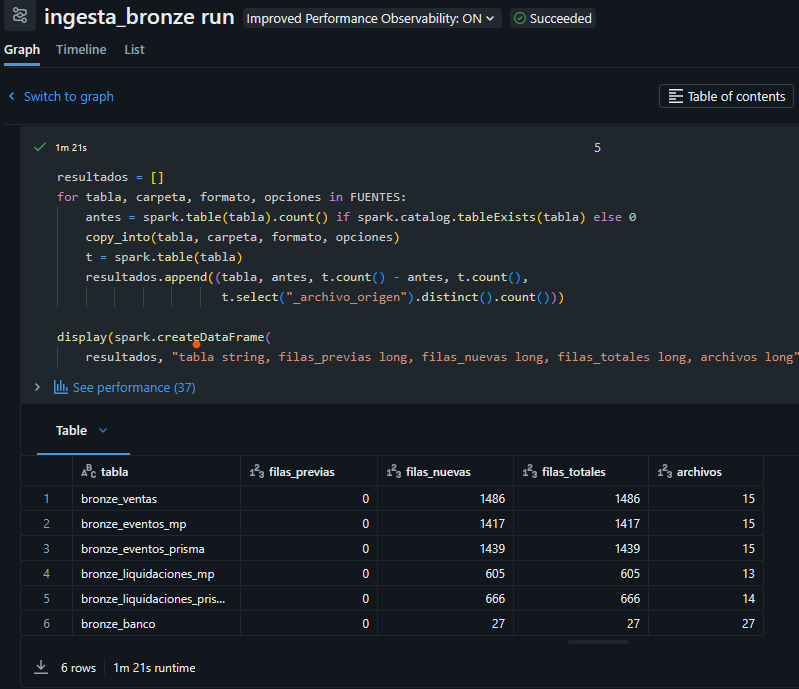

# Evidencia de ejecución

Esta carpeta reúne las capturas de la ejecución del Job `tp-final-conciliacion-medallion` en Databricks Free Edition, realizada el 27 de octubre de 2026 sobre cómputo serverless.

## Configuración del Job

**`01_dag_job.png`** — Grafo de tareas del Job, con las cinco tareas encadenadas y ejecutadas sobre cómputo serverless.

**`02_configuracion_job.png`** — Parámetros del Job (`catalogo`, `schema` y `hasta_fecha`) y cómputo serverless.

## Ejecuciones

**`03_ejecuciones_job.png`** — Listado de las tres ejecuciones del Job (primera quincena, mes completo y reejecución), todas finalizadas con éxito, con su duración.

**`04_ejecucion_1_bronze.png`** — Salida de la tarea `ingesta_bronze` en la primera ejecución (`hasta_fecha = 2026-01-15`): carga inicial de cada fuente.

**`05_ejecucion_2_bronze.png`** — Salida de la misma tarea en la segunda ejecución (`hasta_fecha = 2026-12-31`): Bronze incorpora únicamente las filas de los archivos nuevos.

**`06_ejecucion_3_bronze.png`** — Salida de la misma tarea en la reejecución: ninguna fila nueva en ninguna fuente.

**`07_validacion.png`** — Salida de la tarea `validate_pipeline` en la tercera ejecución: los once controles satisfactorios y la tabla de auditoría, en la que las reejecuciones con la misma fecha de corte registran `idempotencia_comparada = true`.

## Verificación de resultados (`notebooks/05_verificacion`)

**`08_esperado_vs_observado.png`** — Comparación con el ground truth: las 33 métricas presentan el estado `OK`.

**`09_kpi_psp.png`** — Indicadores por PSP.

**`10_no_conciliadas.png`** — Monto no conciliado por capa y motivo.

**`11_evolucion_semanal.png`** — Evolución semanal del monto no conciliado en enero de 2026.

**`12_paridad_dw_original.png`** — Montos no conciliados de enero de 2026 con el mismo corte que la consulta D.2 del Data Warehouse original.

